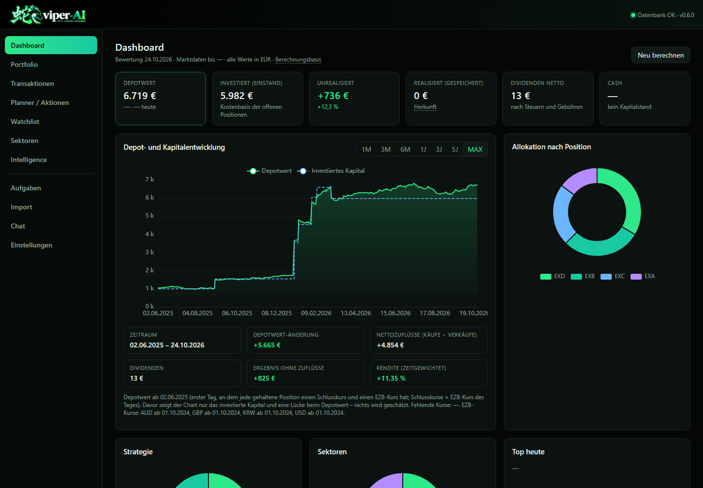
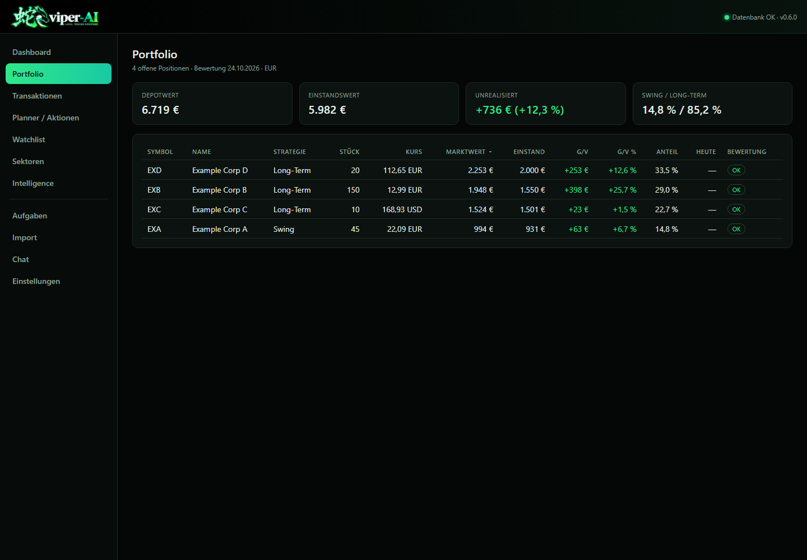
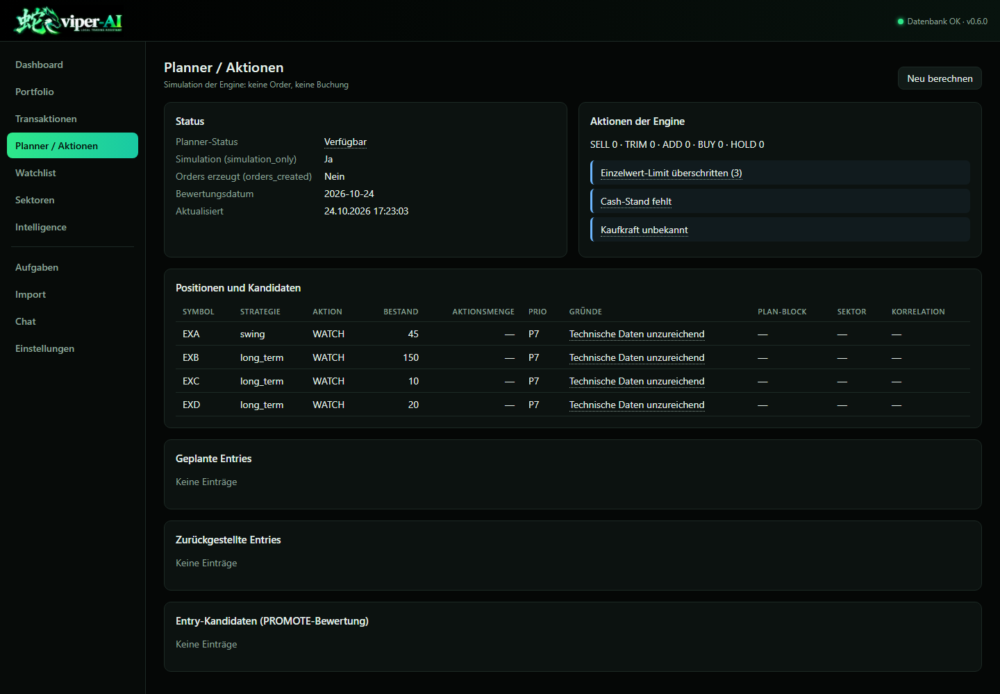
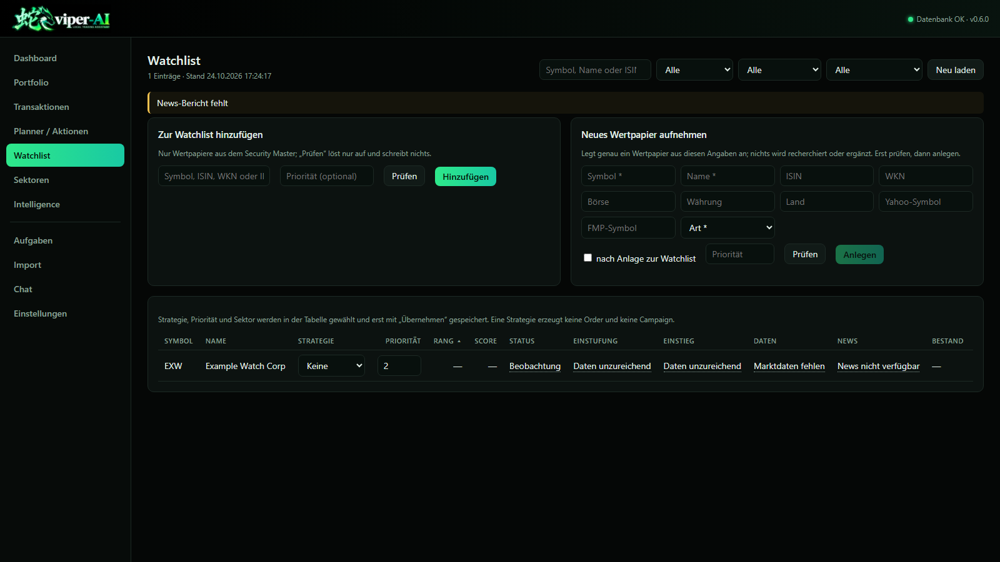
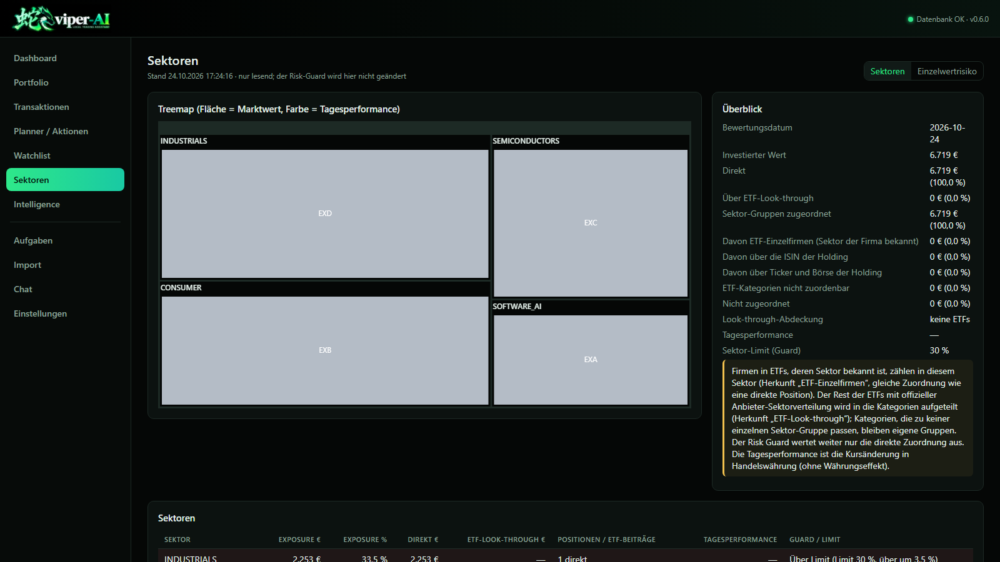
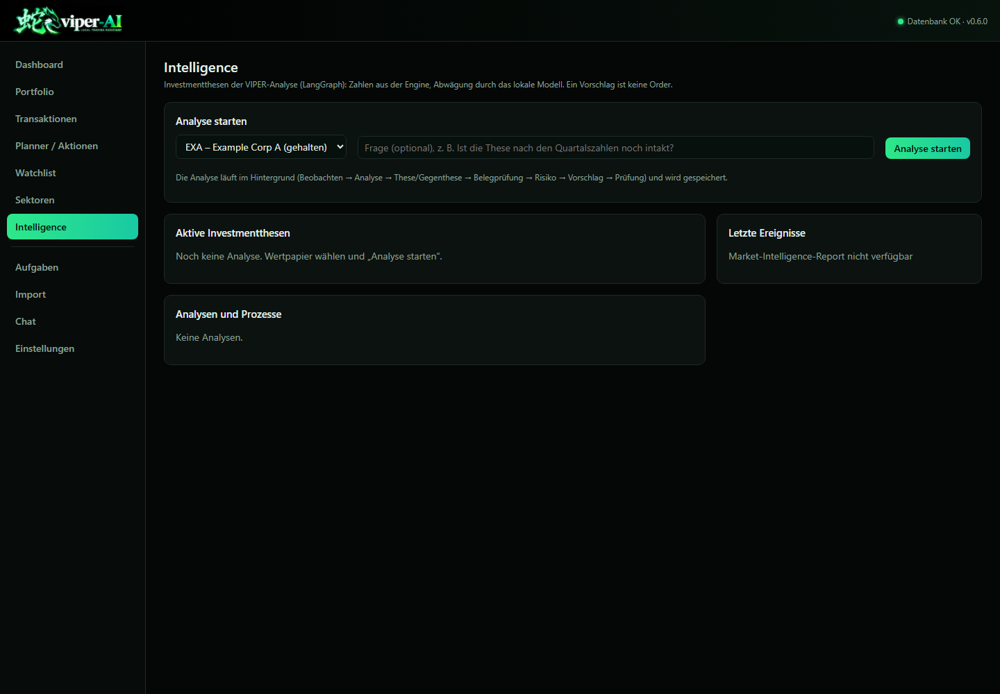
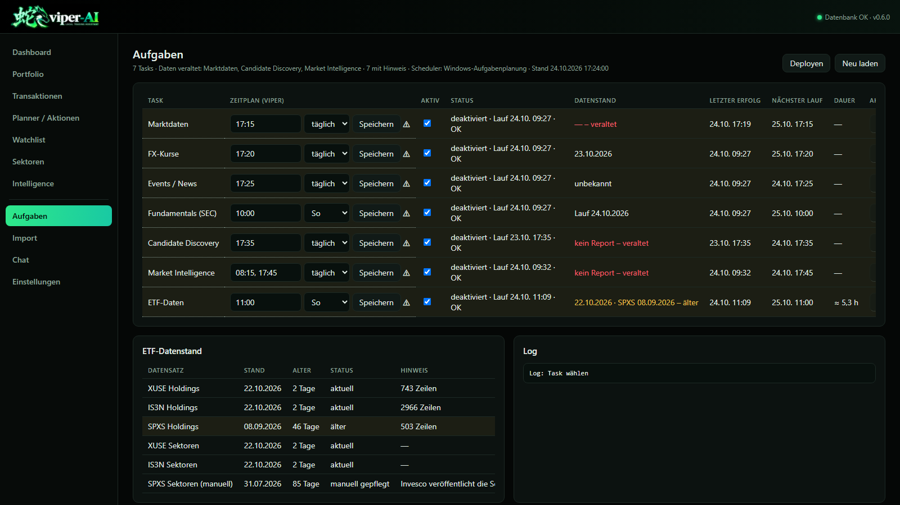

# Web front end

Deutsche Version: [web.de.md](web.de.md)

The web front end is the interface of VIPER-AI in the local browser. It is the only user interface (the former Qt desktop GUI is removed completely); the plan and its state are in the roadmap of the repository. It holds no trading logic: every figure comes from the existing engine.

## 1. Architecture

```
Browser (http://127.0.0.1:8765/)
  |-- static page (HTML, CSS, JavaScript)
  `-- /api ----- FastAPI (web/app.py)
                   |-- facade trading_sqlite.Tools in its own process (READ tools + GUI actions)
                   `-- engine module portfolio_history (read-only)  ----- SQLite
```

- The tools are the same methods of the class `Tools` that the MCP server offers; they run in the process of the web server, without an MCP child process.
- Allowed is exactly what the former desktop GUI was allowed to do: the READ tools and the actions of `GUI_ACTIONS` in `tool_policy.py`. `sql_execute`, `approve_swing_promotion` and every unknown name are refused (HTTP 403, `TOOL_NOT_ALLOWED`).
- Values that no tool provides (holdings with cost basis, transactions, daily bars, portfolio history) come from `portfolio_history.py` over a read-only connection (`mode=ro`, `query_only`).
- The page uses Apache ECharts 5.6.0 (dashboard charts) and TradingView Lightweight Charts 4.2.3 (price charts), both shipped under `web/static/vendor`; it loads nothing from the internet.
- The server listens on 127.0.0.1 only. A write (anything but `GET`/`HEAD`/`OPTIONS`) is accepted only with the `Host` `127.0.0.1:<port>` or `localhost:<port>` of this server and, when the browser sends an `Origin`, only with `http://127.0.0.1:<port>` or `http://localhost:<port>`; anything else gets HTTP 403 (`FOREIGN_ORIGIN`). This keeps out foreign web sites in the browser and redirected host names (DNS rebinding). There is deliberately no login, no users and no tokens.

## 2. Installation and start

The web front end needs the extra `web` (package `fastapi`; `uvicorn` comes with `mcp`):

```
<venv>\Scripts\python.exe -m pip install "VIPER-AI[web] @ <source>"
viper-ai-web
viper-ai-web --port 8766 --no-browser
viper-ai start
```

- `viper-ai-web` runs with a console; `viper-ai start` and `viper-ai-start` (no console window, for the shortcut and the autostart) start the same server in the background and open the browser. If VIPER already runs, only the browser is opened.
- The web never starts a job on its own, not at a start or restart either (section 7). `--no-scheduler` is still accepted but has no effect.
- Without `--db` the `trading_db_path` of the settings file (section 6) applies, otherwise `<root>\data\trading.db` from `runtime_paths`.
- In the repository `python -m web` starts the same; in the installation also `python -m viper_ai.web`.

## 3. API

| Path | Content | Source |
|---|---|---|
| `GET /api/status` | version, database status, Ollama status (a real check with a short timeout: reachable and the chosen model present), path, hints | `database_status`, Ollama |
| `GET /api/portfolio` | open positions with market value, cost basis, unrealised result, daily change; totals | `portfolio_history.holdings` |
| `GET /api/portfolio/history` | daily values (invested capital, market value, net flow, dividends in EUR), figures per period, missing prices, ECB stand | `portfolio_history.portfolio_history` |
| `GET /api/transactions` | stored transactions, newest first (`security_id`, `limit`) | `portfolio_history.transactions` |
| `GET /api/securities/{id}/prices` | daily bars of one security in its trading currency | `portfolio_history.price_history` |
| `GET /api/views/dashboard` | planner and engine block of the desktop dashboard (the same texts and tables) | `run_trading_orchestrator`, `database_status` |
| `GET /api/views/planner`, `/api/views/watchlist`, `/api/views/sectors`, `/api/views/tasks` | tables and texts of the pages Planner, Watchlist, Sektoren (with the single-name exposure) and Aufgaben | view models of `viper_ai/shared/viewmodels` |
| `POST /api/watchlist/add`, `/api/watchlist/{id}/remove`, `/api/watchlist/{id}/edit`, `/api/onboarding` | watchlist actions and adding a new security (check, then create) | `add_watchlist_candidate`, `remove_watchlist_candidate`, `set_security_strategy`, `set_watchlist_priority`, `set_security_sector`, `onboard_security` |
| `POST /api/tasks/deploy`, `/api/tasks/{name}/edit` (`times`, `day`, `enabled`), `/delete`, `/restore`, `/run`; `GET /api/tasks/{name}/log` | deploy the definitions to the scheduler, change a task, enable/disable, delete, restore, run now, read the end of the log | `viper_ai.tasks` (section 7) |
| `POST /api/import/upload`, `/api/import/check`, `/api/import/run` | store an export file, check it, import with the token of that check | `check_transaction_import`, `import_transactions` |
| `POST /api/chat` | question to the local model, answer as Server-Sent Events; `/api/chat/stop`, `/api/chat/reset` | Ollama, READ tools |
| `GET /api/diagnostics`, `GET` and `POST /api/settings` | paths, status, tool classification; settings | settings file |
| `GET /api/intelligence`, `GET /api/intelligence/cases/{id}`, `GET /api/intelligence/securities` | current theses with reasons for a re-evaluation, analysis cases with their step protocol, securities to choose | `analysis_store` |
| `POST /api/intelligence/analyze`, `POST /api/intelligence/cases/{id}/resume`, `POST /api/intelligence/cases/{id}/cancel` | start an analysis (`security_id`, `question`, `supersedes_id`), continue an interrupted analysis, cancel a running analysis (ends the model call in progress) | `viper_reasoning`, Ollama |
| `GET /api/orchestrator` | the complete orchestrator result (cached for 60 seconds, `refresh=true` computes it again) | `run_trading_orchestrator` |
| `POST /api/read/{tool}` | any READ tool with its arguments as JSON | READ tools |
| `POST /api/action/{tool}` | one GUI action with its arguments as JSON | `GUI_ACTIONS` |

The OpenAPI description is at `/api/docs`.

## 4. Calculation basis

- Market value of a position: the value of `build_portfolio_context` (shares x latest snapshot price x ECB rate). If one valuation is missing, there is no total.
- Cost basis: `remaining_cost_basis` of the table `positions` (average-cost model of the import); unrealised result = market value - cost basis.
- Daily change: `close / previous_close - 1` of the two latest daily bars (trading currency, without currency effect), as on the sector page.
- Realised result: sum of `realized_gain` of `positions`; dividends: DIVIDEND amounts minus taxes and fees.
- Portfolio history: the transactions are replayed day by day with the same cost model (`apply_cost_basis`) and the same split factors. The market value of a day is shares x close x ECB rate of that day; if a held position has no price or no ECB rate (older than 5 days) on a day, the day has no market value (`missing` names the symbols). The invested capital is always known, because the amounts are stored in EUR.
- Performance per period (1M, 3M, 6M, 1J, 3J, 5J, MAX): the net flow of a day = buys (amount + fees + taxes) minus sells (amount - fees - taxes); dividends are income. Daily return = (market value - net flow + dividends) / market value of the day before - 1, chained to the time-weighted return; a day without a market value in the period makes the return "not computable". MAX starts with the first fully valued day. Market value and return are separate figures.

## 5. Pages

| Page | Content |
|---|---|
| Dashboard | market value with daily change, cost basis, unrealised and stored realised result, dividends, cash; portfolio and capital history with periods (1M, 3M, 6M, 1J, 3J, 5J, MAX) and the figures of the period; allocation by position, strategy and sector; top/flop today and by result; positions; planner and hints of the engine |
| Portfolio | every open position with price, market value, cost basis, result, weight, daily change and valuation status; sortable |
| Position | price history as a candlestick chart with buys and sells, figures of the position, transactions of the security |
| Transactions | every stored transaction with a filter by symbol, name and type |
| Planner / Aktionen | engine actions per position, planned and deferred entries, entry candidates with sector and correlation risk |
| Watchlist | table with filters and sorting; strategy, priority and sector are chosen in the table, the apply button saves (strategy, then priority, then sector; a failure stops the sequence); add with a check, remove after a confirmation; "Neues Wertpapier aufnehmen" (check, create only after a clean check of the unchanged form) |
| Sektoren | treemap and tables of the sectors, ETF look-through; tab "Einzelwertrisiko" with its own treemap, company and ETF table |
| Aufgaben | the seven VIPER tasks: schedule (time(s) and day) and the enabled switch of the VIPER definition, state in the scheduler with last run and result, next run, data stand, difference of the scheduler from the definition (⚠), run now after a confirmation (through the scheduler, followed until its end), end of the log, delete and restore, "Deployen"; below, the ETF data stand |
| Import | choose the file, check (writes nothing), decide open points (every decision needs a new check), import with the token of the check after a confirmation |
| Chat | questions to the local model with the READ tools of the MCP profile `read`; answer, thinking, tool calls and errors kept apart; stop, new chat |
| Intelligence | start an analysis; active theses with proposal, engine action, confidence, data stand, validity and reasons for a re-evaluation; analyses and processes with their duration (continue after an interruption); latest events |
| Analyse | one analysis case. While it runs, the step protocol shows the active step at once ("läuft" or "Modell läuft") with its start and a running duration, the head the total running time; "Analyse abbrechen" ends the model call in progress. Finished: on top proposal, engine, confidence, data quality and validity with a line saying whether analysis and engine agree, below it a warning when the data quality is limited; thesis and counter-thesis in short with collapsible evidence, a short rationale of the proposal, news with a collapsible list, assumptions, uncertainty and data gaps apart, risk and portfolio context, metrics with readable names (technical fields collapsible), evidence catalogue, actual transactions since the analysis; at the bottom the step protocol as the technical audit view (kind, start, end, duration, result or error, for example "Ollama-Timeout nach 300 s") |
| Einstellungen | diagnostics (paths, database, Ollama, tool classification) and the settings the web uses; the model is chosen from every model of the running Ollama (one not installed is marked) |

- Data stand, currency and calculation basis are named in the head of every page; the tooltip "Berechnungsbasis" gives the rules of section 4.
- On the Analyse page small evidence marks with a readable name take the place of the technical evidence ids (`metric:rsi14`, `news:<id>`); a click shows id, value and source, and the evidence catalogue stays complete. Opened details stay open when the page refreshes, and the browser counts the running times itself. The running step appears once `viper-ai run Migrate-TradingAnalysisCases.py --write` has run (version 2: `analysis_step.finished_at` may be empty, existing rows are kept); before that, a step is entered after it ends, as before.
- The top right shows "Datenbank OK/Fehler" and "Ollama OK/Fehler" (yellow "Modell fehlt" when Ollama runs but the configured model is not installed; details in the tooltip and on the settings page) and the gear that opens the settings. An unreachable Ollama affects only chat and analyses; dashboard, portfolio and engine keep working.
- ☰ at the top left collapses the navigation to a bar of icons (the name as tooltip) and expands it again; the content then uses the freed width. The state is kept per browser (localStorage). In narrow windows ☰ shows and hides the navigation as before.
- The periods and their figures are computed by the engine (section 4); the page only cuts the daily values for the chart and shows gaps as a break in the line.
- Every page calls the same tool with the same arguments and the same view model as the desktop GUI did; wording, reason code texts, checks and the order of the write steps are the same.
- An import file is stored in the settings folder under `web-import` (the tools only read a local path); it is never part of the package or of the runtime root.
- The chat builds the MCP server in the profile `read` in its own process (without starting it) and gives the model its tools: the same names, descriptions, schemas, compact answers and the same limit of 40,000 characters as any MCP client.
- "Neu berechnen" makes the orchestrator compute again at once instead of showing the result of up to 60 seconds ago.

## 6. Start, settings and production

- `viper-ai-start` is the standard start without a console window (target of the desktop shortcut and of the autostart `viper-ai-start --no-browser` in the folder `shell:startup`); `viper-ai start` does the same from a console, `viper-ai-web` runs with a console. The former `viper-ai-gui` no longer exists.
- Without a console the server writes its output to `web.log` in the settings folder. The settings folder comes from `runtime_paths`: Windows `%LOCALAPPDATA%\VIPER-AI`, Linux `$XDG_CONFIG_HOME/viper-ai` (`~/.config/viper-ai`). It holds `settings.json` (Ollama URL and model, database, refresh, thinking); the settings page changes them. As long as there is no `settings.json` there, the one of the former folder `%LOCALAPPDATA%\TradingAgentGui` is read (never changed); the first save writes to the new folder.
- The log folder of the tasks and the task definitions are in the runtime root (`<root>\logs`, `<root>\scheduler\tasks.json`); they are no setting any more.

Switching production over to this version (each step can be undone, runtime data stays untouched):

1. Install the new version with the extra `web` (also from a checkout without cleaning up first: every build starts from an empty `build/lib`). The extra `[gui]` no longer exists.
2. Switch the shortcuts: autostart (`shell:startup\VIPER-AI.lnk`) and desktop shortcut to `<venv>\Scripts\viper-ai-start.exe` (the autostart with `--no-browser`); `viper-ai-gui.exe` is removed by the upgrade.
3. `viper-ai tasks deploy`: deploys the seven definitions (action, schedule, settings, **enabled state**) to the Windows Task Scheduler. Tasks that were disabled (for example after the takeover by the integrated scheduler, which is removed now) are enabled again. Check with `viper-ai tasks list`.
4. Way back: install the previous version again; the tasks stay as they are (name, action and schedule did not change).

## 7. Tasks (scheduled tasks)

VIPER holds the definitions of the seven tasks itself; the scheduler of the operating system is only where they are deployed to.

```
viper_ai/tasks/definitions.py   the seven tasks (name, script, arguments, schedule, enabled, time limit, at login)
  + <root>/scheduler/tasks.json  changes of this installation (schedule, enabled, deleted)
          |
          +--> Windows: Task Scheduler      (viper_ai/tasks/windows.py, task XML, Register-ScheduledTask)
          +--> Linux:   systemd user timers (viper_ai/tasks/linux.py, viper-<task>.service + .timer)
```

| Task | Script and arguments | Schedule (local time) | Time limit | At login |
|---|---|---|---|---|
| `Trading-MarketData-Backfill` | `Backfill-TradingMarketData.py --write` | daily 17:15 | 72 h | yes |
| `Trading-FXRates-Backfill` | `Backfill-TradingFXRatesECB.py --write --quote-currency USD,GBP,AUD,KRW` | daily 17:20 | 72 h | yes |
| `Trading-EventsNews-Backfill` | `Backfill-TradingEventsNews.py --write` | daily 17:25 | 72 h | yes |
| `Trading-Fundamentals-SEC` | `Backfill-TradingFundamentalsSEC.py` | Sun 10:00 | 72 h | yes |
| `Trading-Candidate-Discovery` | `Discover-TradingCandidates.py` | daily 17:35 | 2 h | no |
| `Trading-Market-Intelligence` | `Collect-TradingMarketIntelligence.py` | daily 08:15 and 17:45 | 2 h | no |
| `Trading-ETF-Refresh` | `Refresh-TradingEtfData.py --write` | Sun 11:00 | 1 h | no |

- Every run is `Run-TradingTask.py <root>/logs/<log> <script> [arguments]` with the Python of this installation (Windows `pythonw.exe`, no console window); the launcher appends the output to the log and hands on the exit code.
- `viper-ai tasks deploy` (or "Deployen" on the Aufgaben page) creates missing tasks, updates differing ones (action, paths, schedule, settings, enabled) and removes deleted ones; a second run changes nothing. If a task is changed outside VIPER, the page shows the difference, and the next deploy puts the VIPER definition back.
- `viper-ai tasks edit <task> --at HH:MM[,HH:MM] --day daily|monday..sunday --enable|--disable` (or the fields of the page) changes the VIPER definition and deploys the task at once. `delete <task>` marks it deleted in VIPER and removes it from the scheduler; `restore <task>` brings back the built-in definition. `run <task>` starts it now through the scheduler (never a running, disabled or undeployed one). `list` and `status` show definition, state, runs and differences.
- Only the seven VIPER tasks are ever touched; another name is refused, systemd files without the VIPER marker are never overwritten or deleted.
- Windows: start times as local time without a UTC offset (`2026-01-01T17:15:00`), so the wall-clock time stays across summer and winter time; `StartWhenAvailable` catches up missed runs, `MultipleInstancesPolicy IgnoreNew` prevents a second run at the same time; the task runs as the logged-on user without a stored password. `deploy` refuses when the user environment variable `VIPER_TRADING_ROOT` (or the default) is not the root deployed for.
- Linux: `OnCalendar=*-*-* 17:15:00` or `Sun *-*-* 11:00:00` in the local time zone (safe across summer time), `Persistent=true` catches up missed runs, a running `oneshot` service is not started a second time, `TimeoutStartSec` is the time limit, `VIPER_TRADING_ROOT` is set in the service. "At login" = the service hangs on `default.target` of the user manager. For timers to run without a login: `loginctl enable-linger <user>` (optional).
- VIPER has no scheduler process: the web server plans and starts nothing on its own. The integrated scheduler introduced in M3a (APScheduler) is removed; the tables `scheduled_job` and `job_run` of a database it ran on stay untouched and are not read.

## 8. Views

Taken with a demo database with fictional values (sample file `examples/trading-import-example.csv`, artificial prices); no real portfolio data.








